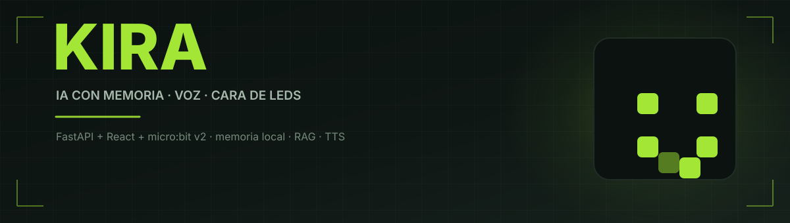
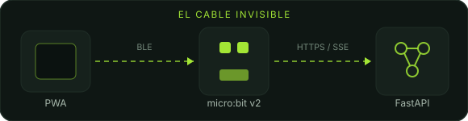

<div align="center">



<br/>

<a href="#qué-es-kira"></a>
<a href="#arquitectura"></a>
<a href="#puesta-en-marcha"></a>
<a href="#el-microbit"></a>

<br/>


<br/><br/>


</div>


<h3 align="center">QUÉ ES KIRA</h3>

<p align="center">
Kira es una IA conversacional con <b>cuerpo físico</b>. El cerebro corre en un servidor,
la cara vive en una <b>micro:bit v2</b> de 25 LEDs y la conversación sucede en el celular,
como una app instalable.
</p>

<p align="center">
No es un chatbot con una personalidad escrita de antemano: <b>la construye viviendo</b>.
Cada charla deja recuerdos, los recuerdos se vuelven hechos, los hechos se vuelven opiniones
que puede citar. Si le preguntás de dónde sacó algo, te muestra la fuente.
</p>

<div align="center">

|  |  |
|:--|:--|
| 🎭 **8 emociones** | `happy` · `sad` · `angry` · `surprised` · `neutral` · `fastidio` · `miedo` · `cansado` |
| 🧠 **Memoria viva** | JSONL + RAG local (embeddings + FTS5, fusión RRF) |
| 🗣️ **Voz** | TTS por frases sincronizado con la boca de la placa |
| 👁️ **Visión** | Lee fotos de la cámara del celular |
| 🛠️ **38 herramientas** | sensores, web, clima, astronomía, juegos, memoria |
| 🔌 **BLE** | el navegador hace de cable entre el servidor y la placa |

</div>


<h3 align="center">ARQUITECTURA</h3>

<div align="center">

</div>

<p align="center">
El celular abre la PWA y habla con el backend por <b>SSE</b> (el texto se revela palabra por palabra,
la voz arranca antes de que termine la respuesta). El backend manda los comandos de la cara a la placa
por <b>Web Bluetooth</b>: si no hay cable USB, el navegador es el cable.
</p>

```text
Kira/
├─ Cerebro/
│  ├─ Backend/        FastAPI · memoria · RAG · IA · hardware
│  │  ├─ app/
│  │  │  ├─ api/          auth · chat · audio · device · system
│  │  │  ├─ domain/       reglas puras y validaciones
│  │  │  ├─ services/     IA, memoria, clima, rastro, mundo
│  │  │  ├─ hardware/     serial, micro:bit, BLE
│  │  │  └─ intelligence/ herramientas de la IA
│  │  └─ kira_server.py   facade de compatibilidad
│  ├─ Frontend/      React + Vite + PWA
│  │  └─ src/
│  │     ├─ componentes/  UI
│  │     ├─ hooks/        motor de conversación, BLE, ajustes
│  │     └─ lib/          API por dominio, utilidades
│  └─ Personaje/     kira.json (identidad y estilo)
└─ MicroBit/         firmware C++ (CODAL)
```


<h3 align="center">CÓMO PIENSA</h3>

<table align="center">
<tr>
<td width="50%" valign="top">

**El turno**

1. El mensaje entra por `/api/chat/stream`
2. Se buscan recuerdos relevantes (RAG)
3. La IA responde en streaming
4. El texto se revela al ritmo de la voz
5. La emoción viaja a la placa
6. Al cerrar, se guarda lo que valga la pena

</td>
<td width="50%" valign="top">

**La memoria**

- `recordar` — interruptor maestro
- `hechos` — datos con evidencia
- `experiencias` — resumen por charla
- `usar` — consultar al responder

Todo local: la fuente de verdad es
`memoria/*.jsonl`, el índice RAG es
**derivado y reconstruible**.

</td>
</tr>
</table>


<h3 align="center">PUESTA EN MARCHA</h3>

**Requisitos:** Python 3.10+, Node 18+, y opcionalmente una micro:bit v2.

```bash
git clone https://github.com/KazenDev/Kira.git
cd Kira
```

<table align="center">
<tr>
<td width="50%" valign="top">

**Backend**

```bash
cd Cerebro/Backend
python3 -m venv .venv
./.venv/bin/pip install -r requirements.txt

cp .env.example .env
# completá las claves (ver abajo)

./run.sh
```

Queda en `http://127.0.0.1:8000`.

</td>
<td width="50%" valign="top">

**Frontend**

```bash
cd Cerebro/Frontend
npm install
npm run dev
```

Queda en `http://127.0.0.1:5173`
y proxea `/api` al backend.

</td>
</tr>
</table>

**Claves necesarias** (en `Cerebro/Backend/.env`):

| Variable | Para qué | Obligatoria |
|:--|:--|:--:|
| `HIVE_API_KEY` | IA (DeepSeek V4.1 Flash) | sí |
| `ELEVENLABS_API_KEY` | voz de Kira | para oírla |
| `ASSEMBLYAI_API_KEY` | transcribir voz del celular | para hablarle |
| `EXA_API_KEY` | búsqueda web | opcional |
| `AI_GATEWAY_API_KEY` | respaldo de IA | opcional |


<h3 align="center">EL MICRO:BIT</h3>

<p align="center">
La placa no es un adorno: es su cara y sus sentidos.
</p>

<div align="center">

| Comando | Qué hace |
|:--|:--|
| `LOADING` | cara pensando mientras la IA responde |
| `TALK` | la boca se mueve con el audio real |
| `EMOCION:<x>` | dibuja y anima la emoción |
| `ESCUCHAR` | arma el micrófono (A abre, A envía, B cancela) |

</div>

<p align="center">
<b>Herramientas reales que la IA puede usar:</b><br/>
<sub>temperatura · luz · sonido · botones · gestos · brújula · acelerómetro
· voltaje · logo táctil · clima · calidad del aire · sismos · astronomía
· web · cálculo · recuerdos · juegos · LEDs</sub>
</p>

<p align="center">
<sub>La temperatura es la del <b>chip</b>, no la ambiente — y así se lo dice a quien pregunte.
El gesto nunca se presenta como velocidad. La brújula avisa si está sin calibrar.
Prefiere decir "no sé" antes que inventar.</sub>
</p>


<h3 align="center">VERIFICACIÓN</h3>

<div align="center">

```bash
cd Cerebro/Backend && ./.venv/bin/pytest -q     # 7 tests
cd Cerebro/Frontend && npm test                 # 114 tests
cd Cerebro/Frontend && npm run build            # build + PWA
```

</div>


<h3 align="center">PRIVACIDAD</h3>

<p align="center">
La memoria y el índice viven en tu máquina. Las conversaciones pasan por los proveedores
de IA y TTS configurados, y nada más. Los datos de cada cuenta están aislados en su propio
directorio: memoria, diario, conversaciones, grabaciones y RAG derivado.
</p>

<p align="center">
<sub>No se versionan credenciales, bases SQLite, memorias ni grabaciones.</sub>
</p>


<h3 align="center">DOCUMENTACIÓN</h3>

<div align="center">

| Documento | Contenido |
|:--|:--|
| [`Cerebro/ARQUITECTURA.md`](Cerebro/ARQUITECTURA.md) | capas del backend y contrato de endpoints |
| [`Cerebro/PLAN_PERSONALIDAD_EMERGENTE.md`](Cerebro/PLAN_PERSONALIDAD_EMERGENTE.md) | el modelo de personalidad que se construye sola |
| [`MicroBit/MICROBIT.md`](MicroBit/MICROBIT.md) | firmware, emociones y protocolo serial |
| [`MicroBit/MEMORIA.md`](MicroBit/MEMORIA.md) | mapa real de RAM y flash de la placa |
| [`REQUISITOS.md`](REQUISITOS.md) | todo lo necesario en una PC limpia |
| [`TODO.md`](TODO.md) · [`TODO_RAG.md`](TODO_RAG.md) | hoja de ruta y decisiones de memoria |

</div>


<div align="center">

### Hecho para la feria de ciencias

<sub>Una IA que no finge tener cuerpo: lo tiene.</sub>

<br/><br/>

<a href="https://github.com/KazenDev"></a>
<a href="https://github.com/KazenDev?tab=repositories"></a>

</div>

<a href="https://github.com/KazenDev"></a>
