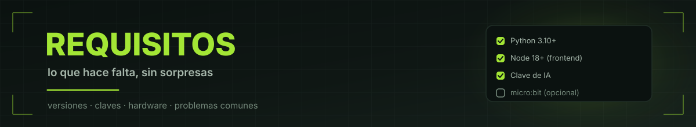

<div align="center">



<br/>

<a href="#python"></a>
<a href="#dependencias-de-python"></a>
<a href="#claves-de-api"></a>
<a href="#hardware-opcional"></a>

<br/>


<br/><br/>

**Lo mínimo para que Kira piense y hable.**<br/>
<sub>Linux, Windows o macOS. Si algo falla, mirá el <a href="#por-qué-no-anda">checklist del final</a>.</sub>

<br/>

**← [README](README.md)** · **[CÓMO HACERLO](COMO-HACERLO.md)** · **[Arquitectura](Cerebro/ARQUITECTURA.md)**

</div>


## Python

| | |
|:--|:--|
| **Versión mínima** | **3.10** (obligatoria: el código usa anotaciones `X \| None`, que no existen en 3.9) |
| **Probado en** | 3.12.3 (recomendado: 3.10, 3.11 o 3.12) |
| **Descarga** | https://www.python.org/downloads/ |

> **Windows:** marcá **"Add Python to PATH"** durante la instalación.


## Dependencias de Python

Las que declara `Cerebro/Backend/requirements.txt`:

| Paquete | Para qué |
|:--|:--|
| `fastapi` | el servidor y la API |
| `uvicorn` | corre FastAPI |
| `httpx` | llamadas a IA, TTS y transcripción (async + streaming) |
| `pyserial` | hablar con la micro:bit por USB |
| `numpy` | audio y VAD |
| `onnxruntime` | corre el modelo Silero de detección de voz |
| `assemblyai` | transcribir audio |
| `simpleeval` | la herramienta `calcular` (eval seguro de matemática) |
| `python-multipart` | subida de archivos (fotos y audio) |
| `fastembed` | embeddings locales del RAG |

Instalación:

```bash
cd Cerebro/Backend
python3 -m venv .venv
./.venv/bin/pip install -r requirements.txt
```

Para desarrollo (agrega `pytest`):

```bash
./.venv/bin/pip install -r requirements-dev.txt
```


## Node.js (solo para el frontend)

| | |
|:--|:--|
| **Versión mínima** | 18 |
| **Uso** | compilar o desarrollar la interfaz |

**No es obligatorio para usar Kira servida por el backend**, pero sí para tocar el frontend:

```bash
cd Cerebro/Frontend
npm install
npm run dev     # desarrollo
npm run build   # producción (genera dist/)
```


## Programas externos

| Programa | Para qué | ¿Obligatorio? |
|:--|:--|:--:|
| **ffmpeg** | convertir el audio del micrófono de la placa a MP3 | solo si grabás voz |
| **Node.js + npm** | recompilar el frontend | solo si tocás la UI |
| **Git** | clonar el repo | sí, si no descargás el ZIP |

**ffmpeg** no viene instalado por defecto:

```bash
# Debian / Ubuntu
sudo apt install ffmpeg

# Arch
sudo pacman -S ffmpeg

# Fedora
sudo dnf install ffmpeg

# Windows (y reiniciá la terminal)
winget install --id Gyan.FFmpeg
```


## Hardware (opcional)

- **micro:bit v2** con el firmware de Kira flasheado (ver [`MicroBit/`](MicroBit/MICROBIT.md)).
- Conexión por **USB**:
  - Windows → puerto `COM*` (Windows 10/11 instala el driver DAPLink solo)
  - Linux → `/dev/ttyACM0`
  - macOS → `/dev/cu.usbmodem*`
- Serial a **115200 baudios**.

En Linux hacen falta permisos para el puerto:

```bash
sudo usermod -aG dialout $USER
# cerrá sesión y volvé a entrar
```

> **Sin placa la app funciona igual.** El chat, la voz y la micro:bit virtual
> andan; solo no hay cara física ni sensores reales. Las herramientas de
> sensores van a responder "no pude leerlo", y está bien: Kira no inventa.


## Claves de API

Todas se cargan en **`Cerebro/Backend/.env`** (copiá `.env.example`).
**Nunca** se escriben en el código ni se commitean: el `.env` está en `.gitignore`.

| Variable | Servicio | Para qué | ¿Obligatoria? |
|:--|:--|:--|:--:|
| `HIVE_API_KEY` | [The Hive](https://thehive.ai) | la IA (DeepSeek V4.1 Flash) | **sí** |
| `ELEVENLABS_API_KEY` | [ElevenLabs](https://elevenlabs.io) | la voz de Kira | para oírla |
| `KIRA_ELEVEN_VOICE_ID` | ElevenLabs | el ID de la voz clonada | para oírla |
| `ASSEMBLYAI_API_KEY` | [AssemblyAI](https://assemblyai.com) | transcribir lo que hablás | para hablarle |
| `EXA_API_KEY` | [Exa](https://exa.ai) | búsqueda web de la IA | opcional |
| `AI_GATEWAY_API_KEY` | Vercel AI Gateway | IA de respaldo | opcional |

> **La IA tiene respaldo en cadena.** Si Hive falla o se queda sin saldo,
> prueba Vercel Gateway y después DeepSeek directo. Los logs avisan:
> `[IA] hive se agotó (HTTP 405) -> CAE AL RESPALDO`.


## Internet

**Obligatorio.** La IA, la voz y la búsqueda web son APIs en la nube.
Sin internet el servidor levanta, pero Kira no puede pensar ni hablar.

La memoria y el índice RAG, en cambio, son **100% locales**.


## Cómo arrancar

### Opción A: launchers (más fácil)

| SO | Acción |
|:--|:--|
| **Windows** | doble clic en `Cerebro/KIRA.bat` |
| **Linux / macOS** | `./Cerebro/KIRA.sh` (la primera vez: `chmod +x Cerebro/KIRA.sh`) |

Instalan las dependencias la primera vez y abren el navegador.

### Opción B: a mano

```bash
# terminal 1 — backend
cd Cerebro/Backend
cp .env.example .env    # completá las claves
./run.sh

# terminal 2 — frontend (desarrollo)
cd Cerebro/Frontend
npm install
npm run dev
```

- Backend: **http://127.0.0.1:8000**
- Frontend dev: **http://127.0.0.1:5173** (proxea `/api` al backend)

Si usás el launcher, todo se sirve desde **:8000** y no hace falta la terminal 2.


## Por qué no anda

<details>
<summary><b>1. ¿Python 3.10 o más?</b></summary>

```bash
python3 --version
```

</details>

<details>
<summary><b>2. ¿Dependencias instaladas?</b></summary>

```bash
cd Cerebro/Backend
./.venv/bin/pip install -r requirements.txt
```

</details>

<details>
<summary><b>3. ¿ffmpeg en el PATH?</b> (solo si grabás voz)</summary>

```bash
ffmpeg -version
```

</details>

<details>
<summary><b>4. ¿Internet?</b></summary>

La IA y la voz son APIs online. Probá:

```bash
curl -I https://api-cdn.thehive.ai
```

</details>

<details>
<summary><b>5. ¿Las claves son válidas?</b></summary>

```bash
curl -s http://127.0.0.1:8000/api/rag/status
```

Si el servidor responde, el backend vive. Los errores de clave aparecen en la
consola del backend con `[IA]` o `[TTS]`.

</details>

<details>
<summary><b>6. ¿La micro:bit aparece?</b></summary>

```bash
# Linux
ls /dev/ttyACM*
```

```bash
# probar la conexión
python3 MicroBit/mb.py test
```

En Windows: `python MicroBit\mb.py test`

</details>


<div align="center">

### ¿Todo listo?

<table align="center">
<tr>
<td align="center" width="50%">

**[CÓMO HACERLO](COMO-HACERLO.md)**<br/>
<sub>la guía paso a paso</sub>

</td>
<td align="center" width="50%">

**[ARQUITECTURA](Cerebro/ARQUITECTURA.md)**<br/>
<sub>cómo está armado por dentro</sub>

</td>
</tr>
</table>

<br/>

**[← Volver al README](README.md)**

</div>
